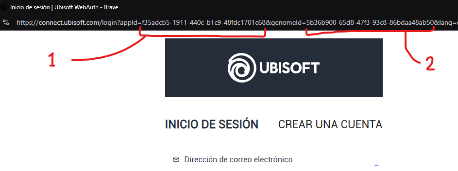
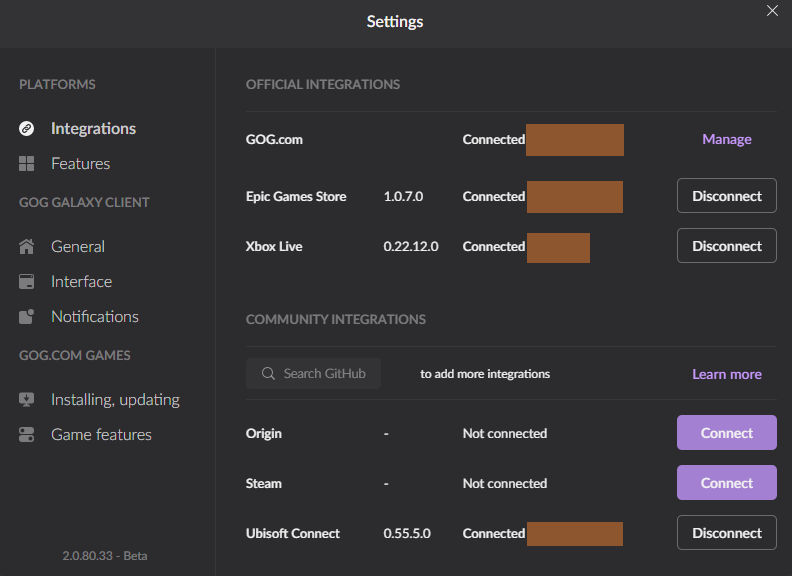

## The issue

When you connect the GOG Galaxy client to Ubisoft Connect, it drops back into a disconnected state just seconds after you sign in to your Ubisoft Connect account through the plugin's login.

## How to fix the issue

???+ note
	This appears to be an open issue in the GitHub repo referenced below. No definitive solution has been found yet, so this method may need to be re-applied from time to time.

A solution shared on Reddit by [u/ved7108](https://www.reddit.com/user/ved7108/) applies here:

> [Not able to connect my ubisoft connect with GoG galaxy](https://www.reddit.com/r/gog/comments/pjsdph/comment/htsh140/?utm_source=share&utm_medium=web3x&utm_name=web3xcss&utm_term=1&utm_content=share_button) (in [r/gog](https://www.reddit.com/r/gog/))

The same fix is discussed in this GitHub issue:

https://github.com/FriendsOfGalaxy/galaxy-integration-uplay/issues/33#issuecomment-1444362239

The steps, for reference:

- Click the "Connect" button in the Ubisoft Connect integration settings in GOG Galaxy
- When the login screen appears, copy the `appId` (1) and `genomeId` (2) values from the pop-up URL


/// caption
Image showing the necessary values to copy from the login URL
///

- Modify the file `%localappdata%\GOG.com\Galaxy\plugins\installed\uplay_afb5a69c-b2ee-4d58-b916-f4cd75d4999a\consts.py`
	- If you use VS Code, you can open it from a PowerShell shell with this command

```powershell
code %localappdata%\GOG.com\Galaxy\plugins\installed\uplay_afb5a69c-b2ee-4d58-b916-f4cd75d4999a\consts.py
```

- Find the lines shown below and replace the values with the ones you copied from the Ubisoft Connect login screen

```
CLUB_APPID = "f35adcb5-1911-440c-b1c9-48fdc1701c68"
CLUB_GENOME_ID = "5b36b900-65d8-47f3-93c8-86bdaa48ab50"
```

- Save the file, then log in from the Ubisoft Connect login screen
- The client should now stay connected, as shown below

!!! info inline end "Remember"
	So far, this fix needs to be re-applied if Ubisoft changes the values on their side


/// caption
Image showing a working connection to Ubisoft Connect after a successful file modification
///
